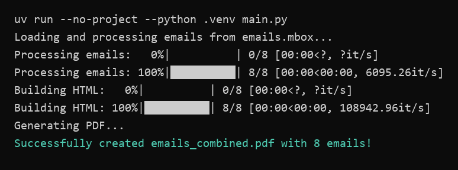
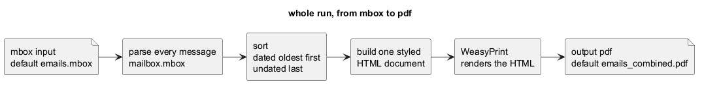
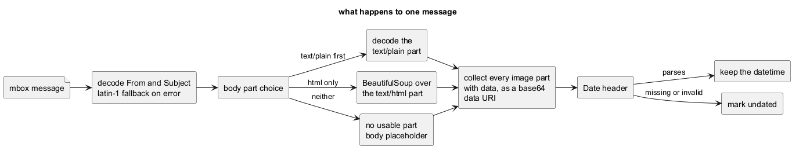

# takeout-to-pdf

[](LICENSE)

Converts a Google Takeout Gmail mbox into one combined pdf, one card per email with sender, date, subject, body text, and embedded images.



console output of a run over an 8 email mbox: both tqdm passes, the pdf write, and the final count line.

## Contents

1. [What it does](#what-it-does)
2. [Architecture and flows](#architecture-and-flows)
3. [Usage](#usage)
4. [Make targets](#make-targets)
5. [Verification](#verification)
6. [License](#license)

## What it does

main.py reads an mbox file, default emails.mbox in the working directory, and writes one pdf, default emails_combined.pdf. Every message becomes a card with From, Date, and Subject headers, the body text, and any embedded images.

For each message the converter:

1. decodes the From and Subject headers, with a latin-1 fallback when the declared encoding is broken
2. prefers the text/plain part and falls back to text/html, stripped to visible text with BeautifulSoup
3. collects every image part and embeds it inline as a data URI, other attachments such as pdf or docx files are not extracted
4. parses the Date header, naive -0000 times are normalized to UTC, messages with a missing or unparsable date land at the end

Dated emails are sorted oldest first, undated ones follow in file order. Header and body text is html escaped before rendering, so markup in a subject appears as literal text. A missing input file, an empty mbox, or a missing output directory stops the run with an error.

## Architecture and flows



the whole run, from mbox to pdf.



what happens to one message.

## Usage

### Windows prerequisite

WeasyPrint renders through Pango and its GTK libraries, which the pip package does not bundle. Install them once:

```
winget install -e --id MSYS2.MSYS2
C:\msys64\usr\bin\pacman.exe -S --noconfirm mingw-w64-x86_64-gtk3
```

Then put C:\msys64\mingw64\bin on PATH so python can load the dlls. On Linux and macOS these libraries come from the normal system packages.

### Export from Google Takeout

1. open takeout.google.com and deselect every product
2. select Mail and create the export
3. unzip the download, the mbox sits under Takeout/Mail as All mail Including Spam and Trash.mbox
4. copy it next to main.py as emails.mbox, or pass its path with -i

### Run

```
make setup
make run
make run ARGS="-i path/to/mail.mbox -o archive.pdf"
```

The direct call without make:

```
uv run --no-project --python .venv main.py -i emails.mbox -o emails_combined.pdf
```

make setup creates a Python 3.14 uv virtual environment and installs weasyprint, beautifulsoup4, and tqdm.

## Make targets

- make help: list every target
- make setup: create the virtual environment and install dependencies
- make run: convert ./emails.mbox into ./emails_combined.pdf, ARGS passes flags through
- make diagrams: render every docs/diagrams/*.puml into a png beside it, the pinned plantuml jar is fetched and checksum verified on first use
- make clean: remove the virtual environment and the output pdf

## Verification

The playground scripts check the documented behavior end to end:

```
python playground/make_mbox.py
make run
uv run --no-project --python .venv playground/verify_pdf.py
```

make_mbox.py writes a synthetic mbox with 8 messages: html bodies, an embedded image, markup in a subject, a -0000 date, an unparsable date, and a missing date. verify_pdf.py extracts the produced pdf text and asserts the sender order, the body contents, the escaped subject, and the embedded image.

## License

MIT, see [LICENSE](LICENSE).
